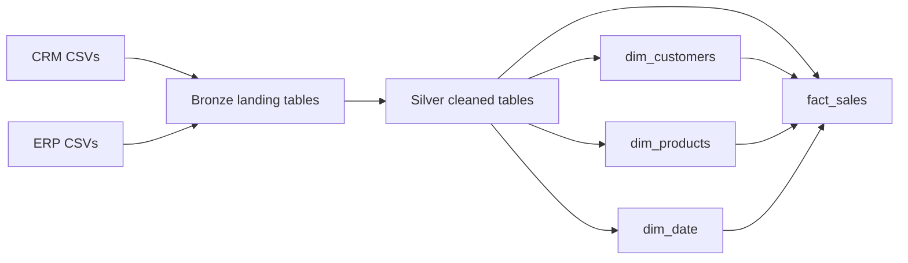

# SQL Server Sales Warehouse

This project turns the included CRM and ERP CSV extracts into a SQL Server warehouse for customer, product, and sales analysis. The source files contain 60,398 sales rows and 397 product records. The warehouse loads the extracts into Bronze, cleans them in Silver, and exposes a Gold model for reporting.

## Model



The sales fact is at the supplied order/product line grain. The sample has no repeated order/product pair, but it has no source line ID; add one if a future extract can contain repeated lines for the same product in an order. Gold stores customer and product dimensions as tables so their identity keys survive reloads. For each product number, Gold uses the latest product version in the source. It does not join historical product attributes as of each sale date.

The date dimension includes order, shipping, and due dates. Order counts in the analysis queries use distinct order numbers because one order can contain multiple product lines.

## Requirements

- SQL Server 2017 or later on Windows.
- SQL Server service account read access to the repository's `datasets` directory. `BULK INSERT` reads files from the SQL Server host, which may differ from the computer running SSMS.
- SSMS or another SQL client that supports `GO` batch separators.

## Setup

1. Run `scripts/init.database.sql`.
2. In `DataWH`, run `scripts/bronze/ddl_bronze.SQL` and `scripts/silver/ddl_silver.SQL`.
3. Run `scripts/migrations/001_upgrade_warehouse.sql`. It is a no-op on a fresh schema and upgrades the earlier project schema in place.
4. Run `scripts/gold/ddl_gold.sql`.
5. Create the load procedures by running `scripts/bronze/proc_load_bronze.SQL`, `scripts/silver/proc_load_silver.SQL`, and `scripts/gold/proc_load_gold.sql`.
6. Load the files. Pass the `datasets` directory, which contains `source_crm` and `source_erp`, using a path visible to SQL Server:

   ```sql
   EXEC bronze.load_bronze @source_root = N'C:\path\to\sql-data-warehouse-project\datasets';
   EXEC silver.load_silver;
   EXEC gold.load_gold;
   ```

7. Run the SQL checks in `tests/` and review any returned rows or mismatched row counts.
8. Run the queries in `analysis/` for monthly sales, product performance, and customer behavior.

The Bronze and Silver loads are full refreshes. Bronze, Silver, and Gold loads use transactions and return errors to the caller. Gold updates dimensions by their natural keys, preserving identity keys for records that remain in the source; newly observed dates are added to `dim_date`.

## Analysis

- `analysis/sales_trends.sql` reports monthly revenue, distinct orders, units sold, and revenue per order.
- `analysis/product_performance.sql` ranks products and categories by revenue and units, using the latest available product attributes.
- `analysis/customer_behavior.sql` reports customer revenue, order frequency, and whether the customer placed more than one order in the available data.

The repository includes SQL analysis queries, not a packaged dashboard. They are starting points for a Power BI report or other BI tool.

## Quality checks

The scripts in `tests/` check key uniqueness, date order, unresolved sales measures, fact-to-dimension joins, declared fact grain, and source-to-target row counts. They return rows for investigation; they do not automatically reject a load.

## Files

- `datasets/` — sample CRM and ERP CSV extracts
- `docs/requirements.md` — project scope and reporting goals
- `docs/data_model.md` — fact grain, dimension keys, measures, and load behavior
- `scripts/` — database, layer DDL, load procedures, and schema migration
- `tests/` — data-quality and reconciliation queries
- `analysis/` — business analysis queries

The sample files include customer names, dates of birth, and gender fields. They are the supplied sample data; do not replace them with production customer data before publishing this repository. No credentials are required by the scripts.

## License

MIT. See [LICENSE](LICENSE).
